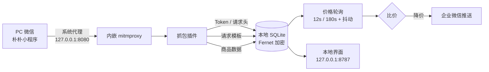

# 朴朴出清监控 · pupu-monitor

盯住朴朴超市的购物车价格和「疯狂折扣」出清商品：降价推送到微信，看到便宜货一键加购。

Windows 桌面程序，**全程本机运行**，数据只存在你自己电脑上。

<p>


</p>

---

## ⚠️ 使用前必读

**这是一个个人自用工具，不是给所有人用的产品。** 请先读完这几条再决定要不要用。

1. **会违反平台用户协议。** 本项目通过抓包重放调用朴朴客户端的接口。这类自动化操作不被平台允许，**可能导致账号被限制**（功能受限、优惠券失效、活动参与资格取消）。
2. **「一键锁单」会真的下单。** 它提交真实订单并占用库存，默认**关闭**。开启后按下的每一次都会产生待支付订单，15 分钟内不付款会自动取消。请自行承担后果。
3. **请只用你自己的账号，不要用别人的。** 本项目读写的全部是你登录账号里的数据。
4. **禁止商业使用。** 不要把它做成收费服务、代买工具、多用户 SaaS。已有爬取平台数据被判高额赔偿的司法案例，性质一旦改变，风险完全不同。
5. **与朴朴、美团、腾讯均无任何关联。** 这是第三方个人项目，不代表任何平台。
6. **作者不承担任何责任。** 账号风险、订单损失、数据问题，全部由使用者自负。
7. **本项目不含任何账号、Token、订单数据。** 你需要自己抓一次包来接入自己的账号。

如果你不能接受以上任意一条，请不要使用。

---

## 它解决什么问题

朴朴的「疯狂折扣」区每天有大量临期、清仓商品，折扣从 2 折到 8 折不等，但：

- 商品太多（实测 240+ 件），一页页刷很费时间
- 想蹲的几件商品什么时候降价，全靠碰运气
- 看到便宜的想买，还要翻回购物车一件件找

这个工具做三件事：**把出清池拉全并排序**、**盯着购物车里的价格**、**降价了立刻推到你微信**。

## 功能

| 功能 | 说明 |
|---|---|
| 🛒 **购物车监控** | 分层轮询：21–23 点每 12 秒一次，其余时间 180 秒一次，带 ±30% 随机抖动（固定节奏最容易被风控标记） |
| ⭐ **重点商品星标** | 购物车卡片点 ☆，**降价 1 分钱就推送**；未星标商品走常规阈值（≥5% 且 ≥0.5 元） |
| 📉 **出清池** | 一键抓「疯狂折扣」全量（13 页 240+ 件），按折扣从低到高排，可筛 ≤7 折 / ≤5 折 |
| 🏷️ **品类筛选** | 本地规则分「肉类 / 海鲜 / 其它」三类，可与折扣筛选叠加 |
| ➕ **一键加购** | 出清池每行一个「加购」，直接进购物车，不用跳 App |
| 🗑️ **删除商品** | 单件或批量移除 |
| ⚡ **一键锁单** | 提交订单占库存、停在支付页，**不付款**；带「撤销锁单」，退单同时商品自动退回购物车 |
| 📍 **地址切换** | 切换收货地址即切门店，购物车和出清池自动跟着换 |
| 🔔 **微信推送** | 企业微信群机器人，降价卡片带商品图、原价、现价、折扣、一键跳转 |
| 🧭 **三步接入向导** | 装证书 → 开代理 → 点一下小程序购物车，全程不需要手机 |

## 工作原理

小程序跑在 **PC 微信**里，它的网络流量走 Windows 系统代理。所以整个方案不需要手机、不需要模拟器：



关键设计：**录下真实请求，之后原样重放**。朴朴的接口除了 Token 还校验 `sign-v2`、`seal-v2`、`pp-storeid` 等一批请求头，其中签名与请求体相关，无法稳定构造。重放让服务端自己算签名，代价是接口改版时模板会失效——但 Token 过期只需重抓一次，模板不用重录。

## 快速开始

### 方式一：源码运行（推荐，能拿到最新代码）

环境：**Windows 10/11** + **Windows 版微信**（用来开朴朴小程序）+ Python 3.12/3.13

```bash
git clone https://github.com/133898952133/pupu-monitor.git
cd pupu-monitor
python -m pip install -r requirements.txt
python desktop.py
```

首次启动会自动弹出接入向导。

### 方式二：打包成 exe

```bash
python -m pip install -r requirements-dev.txt
python tools/release.py both
```

产物在 `dist/`：单文件版 `ChujianMonitor.exe`（约 35 MB）和文件夹版 `dist/ChujianMonitor/`（约 80 MB，启动更快）。

> exe 未做代码签名，首次运行会被 SmartScreen 拦一次，点「更多信息 → 仍要运行」。
> 杀毒软件可能报毒——代理 + 装根证书 + 解密 HTTPS 这几个行为组合起来就是典型的木马特征，属于误报。

## 三步接入

打开程序后，向导会依次要求：

| 步骤 | 做什么 | 说明 |
|---|---|---|
| ① 信任证书 | 点「安装」 | 装进**当前用户**的受信任根存储，不需要管理员权限，随时可卸载 |
| ② 开启代理 | 点「开启」 | 改 HKCU 注册表，**会备份你原来的代理设置**，结束时自动还原 |
| ③ 抓凭证 | 打开微信 → 朴朴小程序 → 点「购物车」 | 界面会实时显示「已捕获 N 条请求」，拿到凭证后「完成」按钮自动亮起 |

点「完成」后自动关代理、还原网络设置。之后每次打开直接进主界面。

## 日常使用

```
[ 购物车 21 ]  [ 出清池 242 ]
                    ↓ 点「抓取疯狂折扣」拉全量
[全部] [肉类] [海鲜] [其它]     [全部] [≤7折] [≤5折]
5.0折  ¥14.95 / ¥29.90   鲜切剔骨火锅清远鸡500g        [加购]
3.5折  ¥ 1.37 / ¥ 3.90   合口美客家腌面300g            [加购]
```

- **蹲降价**：把想蹲的商品放进购物车（不用付款），点 ☆ 标成重点，等微信推送
- **找便宜**：切到出清池，用「≤5折 + 海鲜」筛出半价海鲜，直接加购
- **锁单**：勾选商品 → 「一键锁单」→ 出现待支付订单 → 去 App 付款（或点「撤销锁单」退出）

## 配置

`config.json`（首次运行自动生成，也可参考 `config.example.json`）：

```json
{
  "poll":   { "peak_start": 21, "peak_end": 23, "peak_interval": 12,
              "idle_interval": 180, "jitter": 0.3 },
  "rule":   { "min_drop_pct": 5.0, "min_drop_abs": 0.5 },
  "notify": { "wecom_webhook": "" },
  "danger": { "allow_submit_order": false }
}
```

- **webhook**：企业微信建一个只有自己的群 → 群设置 → 群机器人 → 复制 webhook → 粘到界面顶部
- **allow_submit_order**：锁单总开关，默认 `false`
- 也可以直接在界面里改，不用编辑文件

## 常见问题

<details>
<summary><b>Token 多久过期？要重抓吗？</b></summary>

大约几周到一个月。过期时凭证状态会变成「需重抓」，监控自动暂停（不会拿失效 Token 硬刷），并推送一条提醒。点右上角「接入账号」重走向导即可，**约 30 秒，模板不用重录**。
</details>

<details>
<summary><b>抓不到包怎么办？</b></summary>

按顺序排查：

1. 界面「流量诊断」里累计请求数是否在涨？不涨说明流量没进代理
2. 微信**退出小程序再重进**（小程序会缓存网络配置）
3. 关掉 Clash / 其它 VPN 的 TUN 模式——它会绕过系统代理
4. 确认微信是 Windows 版，且小程序能正常打开

</details>

<details>
<summary><b>分类准不准？</b></summary>

本地关键词规则，不是平台真实分类（朴朴的商品数据里**没有**分类字段，已实证）。准确率在 90% 左右，误判集中在加工品和名称有歧义的商品。词表在 `app/classify.py`，可以自己加。
</details>

<details>
<summary><b>为什么点击按钮没反应？</b></summary>

如果你改过界面代码：浏览器/WebView 里原生 `confirm()` 在 iframe 中会被屏蔽并直接返回 false，必须用页内 `uiConfirm()`。
</details>

<details>
<summary><b>支持小象超市 / 美团买菜吗？</b></summary>

暂不支持。小象没有可用的 H5 入口，接口需要 `mtgsig1.2` 动态签名（随请求体、时间、设备指纹变化），只能走安卓自动化（让 App 自己签名），复杂度显著更高。适配器结构已经预留，见 `docs/ARCHITECTURE.md`。
</details>

<details>
<summary><b>会不会把我的数据传出去？</b></summary>

不会。所有数据存在本地 `data/chujian.db`（Token、地址、模板用 Fernet 加密）。外部请求只有两个：朴朴接口、你自己填的企业微信 webhook。
</details>

## 项目结构

```
pupu-monitor/
├── desktop.py              入口：原生窗口 + 内嵌代理 + 调度
├── app/
│   ├── adapters/pupu.py    朴朴接口适配器（核心）
│   ├── web.py              FastAPI + 内嵌单页
│   ├── scheduler.py        分层轮询
│   ├── sysproxy.py         系统代理与证书（指纹精确匹配）
│   ├── classify.py         三分类
│   └── db.py               SQLite（14 张表）
├── tools/
│   ├── grab_token.py       mitmproxy 抓包插件
│   └── release.py          一键打包发版
├── docs/                   详细文档
└── config.json             配置（不入库）
```

## 文档

| 文档 | 内容 |
|---|---|
| [docs/PUPU-API.md](docs/PUPU-API.md) | 接口逆向笔记：全部路径、字段含义、已知的坑、失效排查顺序 |
| [docs/ARCHITECTURE.md](docs/ARCHITECTURE.md) | 进程模型、数据流、设计决策 |
| [docs/DEV.md](docs/DEV.md) | 开发环境、打包、发版检查清单 |
| [CHANGELOG.md](CHANGELOG.md) | 版本变更与已知问题 |

## 贡献

欢迎提 Issue 和 PR，但请注意：

- **不要提交任何 Token、订单号、收货地址、手机号**（哪怕脱敏不彻底）
- 接口变更的 PR 请附上抓包得到的请求路径与响应结构（同样要脱敏）
- 影响账号安全的行为（提高频率、批量操作）不会被合并

## License

[MIT](LICENSE)。使用即表示你已阅读并接受本文档开头的免责声明。
